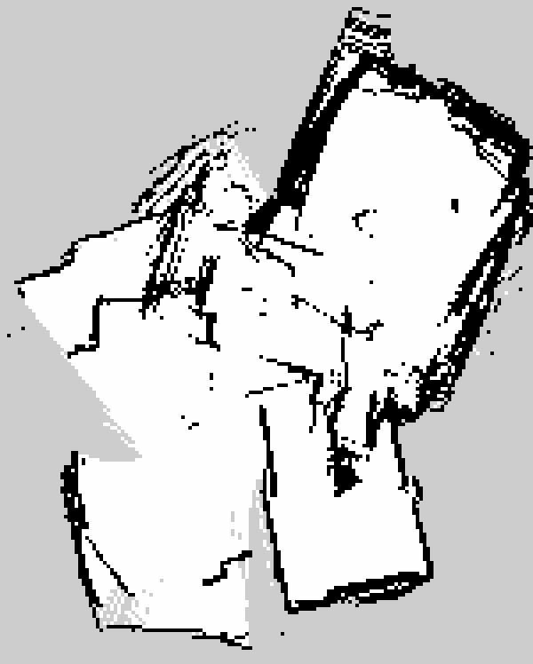

# ldlidar_sl_ros2

ROS 2 driver for the LDROBOT LD14 / LD14P / LD19P (STL-19P) 2D lidars, plus a
ready-made SLAM setup for building a map by carrying the lidar around by hand.

This is a fork of the vendor driver
([ldrobotSensorTeam/ldlidar_sl_ros2](https://github.com/ldrobotSensorTeam/ldlidar_sl_ros2))
via [slgrobotics](https://github.com/slgrobotics/robots_bringup/blob/main/Docs/Sensors/LD14.md),
which added intensity filtering, a constant beam count per revolution and LD19P
support. On top of that this fork adds a `PointCloud2` output, launch files that
survive snap-packaged terminals, and the SLAM configuration described below.

Tested with an LD19P on Ubuntu 26.04 / ROS 2 lyrical. The LD19P runs at
230400 baud and works with the `LDLiDAR_LD14P` product setting, so everything
below that says LD14P applies to it as well.

## Hardware setup

The lidar is connected through a CP2102 USB-to-serial adapter and shows up as
`/dev/ttyUSB0`. Either add yourself to the `dialout` group (log out and back in),
or install the udev rule, which also creates a stable `/dev/ldlidar` symlink:

```bash
cd scripts
./create_udev_rules.sh      # ./delete_udev_rules.sh removes it again
```

## Build

```bash
mkdir -p ~/ldlidar_ws/src
git clone https://github.com/mattiasw2/ldlidar_sl_ros2.git ~/ldlidar_ws/src/ldlidar_sl_ros2
cd ~/ldlidar_ws
colcon build --symlink-install
echo "source ~/ldlidar_ws/install/setup.bash" >> ~/.bashrc
```

Runtime dependencies beyond the ROS 2 base install: `rviz2`, `tf2_ros`,
`slam_toolbox` (SLAM only). On Ubuntu: `sudo apt install ros-$ROS_DISTRO-slam-toolbox`.

## Running the driver

| Launch file | What it starts |
|---|---|
| `ld14.launch.py` | driver for LD14 (115200 baud) |
| `ld14p.launch.py` | driver for LD14P / LD19P (230400 baud) |
| `viewer_ld14.launch.py`, `viewer_ld14p.launch.py` | driver + RViz with `rviz2/ldlidar.rviz` |
| `slam_ld14p.launch.py` | driver + slam_toolbox + RViz map view, see [SLAM](#slam) |

```bash
ros2 launch ldlidar_sl_ros2 viewer_ld14p.launch.py
```

The driver publishes:

| Topic / frame | Type | Notes |
|---|---|---|
| `/scan` | `sensor_msgs/LaserScan` | one message per revolution, about 6 Hz, ~500 beams, 0 to 2π counter-clockwise |
| `/pointcloud2d` | `sensor_msgs/PointCloud2` | same points as `x`, `y`, `z`, `intensity` |
| `base_link -> base_laser` | static TF | lidar 0.18 m above `base_link`; edit the launch file for your mount |

Parameters (set in the launch files):

| Parameter | Default | Meaning |
|---|---|---|
| `product_name` | `LDLiDAR_LD14P` | `LDLiDAR_LD14` or `LDLiDAR_LD14P` (also for LD19P) |
| `port_name`, `serial_baudrate` | `/dev/ttyUSB0`, 230400 | serial device; LD14 uses 115200 |
| `frame_id` | `base_laser` | frame of the published scans |
| `laser_scan_topic_name`, `point_cloud_2d_topic_name` | `scan`, `pointcloud2d` | output topics |
| `laser_scan_dir` | `true` | `true` = counter-clockwise |
| `enable_angle_crop_func`, `angle_crop_min`, `angle_crop_max` | `false`, 135, 225 | zero out ranges inside the angle interval (degrees), e.g. where a robot body blocks the view |
| `min_intensity` | 0 | drop returns with intensity below this value (noise on shiny or distant surfaces) |
| `do_filtering` | `true` | the SDK's near-point filter |
| `do_triplets` | `false` | average each three neighbouring beams into one, cutting the beam count by three |

The beam count per revolution is measured over the first 20 revolutions and
every later scan is padded or trimmed to that count. SLAM front-ends such as
slam_toolbox reject scans whose beam count changes, so this matters.

### Snap-packaged terminals

When launched from the terminal of a snap-packaged application (the snap
version of VS Code, for example), `rviz2` dies with exit code 127 and a
`GLIBC_PRIVATE` error because the snap injects its own library paths. The
viewer and SLAM launch files detect this and restore the original environment
before starting any node, so they can be run from such a terminal.

## SLAM

### What SLAM does

SLAM stands for Simultaneous Localization And Mapping. Building a map from
scans needs the sensor pose for every scan, and knowing the pose needs a map to
match the scan against, so both have to be solved together. Each new scan is
aligned against the map built so far (scan matching), which yields the new
pose, and the scan is then rasterised into the map at that pose. When the
sensor returns to a place it has seen before, loop closure detects the overlap
and distributes the accumulated drift along the whole path.

The output is an occupancy grid, a bitmap with 5 cm cells that are free (white),
occupied (black) or unknown (grey), plus the trajectory as the transform
`map -> odom`.

### How it is set up here

[slam_toolbox](https://github.com/SteveMacenski/slam_toolbox) in online
asynchronous mapping mode. slam_toolbox expects this transform chain:

```
map -> odom -> base_link -> base_laser
 ^       ^         ^
 |       |         static, from ld14p.launch.py
 |       odometry; a static identity transform here, there is no odometry
 published by slam_toolbox
```

Because there is no odometry, two things in `config/slam_toolbox_ld14p.yaml`
differ from the usual defaults:

- `minimum_travel_distance` and `minimum_travel_heading` are 0. slam_toolbox
  decides whether to process a scan by how far odometry says the sensor moved.
  With a static odom frame that is always zero, so the defaults would process
  the first scan and then nothing.
- `minimum_time_interval` (0.2 s) paces scan processing instead, and the scan
  matcher search window is widened to about ±0.3 m and ±30° per processed scan.

### Running it

```bash
ros2 launch ldlidar_sl_ros2 slam_ld14p.launch.py              # driver + slam_toolbox + RViz
ros2 launch ldlidar_sl_ros2 slam_ld14p.launch.py rviz:=false  # headless
```

Keep the lidar level, move at a slow walking pace, turn slowly, and come back
to where you started so the loop can be closed. Save while slam_toolbox is
still running:

```bash
# occupancy grid as room.pgm + room.yaml (what nav2 map_server loads)
ros2 service call /slam_toolbox/save_map slam_toolbox/srv/SaveMap "{name: {data: '/home/me/maps/room'}}"
# pose graph as room.posegraph + room.data (lets slam_toolbox continue or localize later)
ros2 service call /slam_toolbox/serialize_map slam_toolbox/srv/SerializePoseGraph "{filename: '/home/me/maps/room'}"
```

### Result of a first walkthrough

Three rooms of a flat, lidar carried by hand, no odometry, no IMU:



The rooms come out with straight walls and the right proportions, but the
transitions between them show the limits of odometry-free scan matching: where
the lidar was turned quickly in a doorway the matcher lost track for a moment,
so some walls appear twice and the rooms are slightly rotated against each
other. The stray grey wedges are floor hits from tilting the lidar.

Both problems come from the missing motion prior. The next step is an IMU
mounted on the lidar: its gyro gives slam_toolbox the rotation between scans,
which removes the doubled walls, and its roll and pitch allow tilted scans to be
dropped or projected back onto the horizontal plane. A gimbal would only solve
the tilt, so the IMU is the better investment, and it carries over to a robot.

## License

MIT, see [LICENSE](LICENSE). Original driver copyright SHENZHEN LDROBOT CO., LTD.
